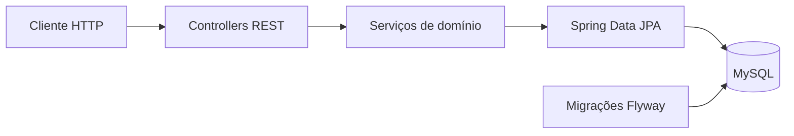

# API TechCollab

**Conecte empresas, profissionais e oportunidades em projetos colaborativos de tecnologia.**

Backend REST para uma plataforma em que empresas publicam projetos e vagas, profissionais registram interesse e equipes são organizadas para executar o trabalho. O repositório concentra os contratos HTTP, a camada de serviços, a persistência e a documentação OpenAPI.

[Recursos](#recursos) · [Arquitetura](#arquitetura) · [Executar](#como-executar) · [API](#explorar-a-api)

## Recursos

| Domínio | Finalidade |
| --- | --- |
| Empresas | Cadastro e gerenciamento de perfis e projetos. |
| Profissionais | Cadastro e informações para participação nos projetos. |
| Projetos | Publicação, consulta de disponíveis, detalhes, edição e exclusão. |
| Vagas | Definição das oportunidades e perfis requeridos por projeto. |
| Interesses | Registro e acompanhamento das candidaturas. |
| Equipes | Organização dos profissionais selecionados. |
| Contratos | DTOs e documentação interativa com Springdoc OpenAPI. |

## Arquitetura



O manifesto declara **Spring Boot 3.4.6**, Spring Web, Data JPA, HATEOAS, Validation, Caffeine, Flyway, MySQL Connector/J, ModelMapper e Springdoc 2.8.8.

Há uma diferença no alvo Java do POM: a propriedade `java.version` está em **22**, enquanto o plugin do compilador explicita `source` e `target` em **21**. Use JDK 22 para reproduzir esta configuração e revise os parâmetros efetivos antes de padronizar o build em outra versão.

## Como executar

Prepare JDK 22, Maven e um MySQL de desenvolvimento. Não utilize um banco que contenha dados de produção para a primeira execução.

```bash
git clone https://github.com/dlr-1337/api-techcollab.git
cd api-techcollab
```

Crie o banco vazio:

```sql
CREATE DATABASE IF NOT EXISTS api_techcollab_database;
```

A configuração da aplicação está em [`src/main/resources/application.yml`](src/main/resources/application.yml). Substitua as credenciais de exemplo por variáveis privadas do ambiente:

| Variável | Valor a configurar |
| --- | --- |
| `SPRING_DATASOURCE_URL` | URL JDBC do banco de desenvolvimento. |
| `SPRING_DATASOURCE_USERNAME` | Usuário restrito ao banco utilizado. |
| `SPRING_DATASOURCE_PASSWORD` | Senha privada, não versionada. |

```bash
mvn spring-boot:run
```

Com a configuração de porta padrão, a aplicação atende em **http://localhost:8080**. O projeto utiliza Flyway e também declara `spring.jpa.hibernate.ddl-auto=update`; revise essa combinação antes de adotá-la em uma implantação com dados importantes.

O plugin Maven do Flyway possui configuração própria no POM, diferente da conexão de runtime. Não suponha que executar um comando `flyway:*` use automaticamente o mesmo banco da aplicação.

## Explorar a API

Abra a [interface Swagger local](http://localhost:8080/swagger-ui.html) com o servidor em execução. Ela apresenta os contratos disponíveis e os modelos de requisição.

Exemplos confirmados em [`ProjetoController.java`](src/main/java/br/com/api_techcollab/controller/ProjetoController.java):

| Método | Rota | Ação |
| --- | --- | --- |
| `GET` | `/api/projetos/disponiveis` | Consultar projetos disponíveis. |
| `GET` | `/api/projetos/{projetoId}` | Consultar um projeto. |
| `PUT` | `/api/projetos/{projetoId}` | Editar usando `ProjetoUpdateDTO`. |
| `DELETE` | `/api/projetos/{projetoId}?empresaId=...` | Excluir a partir do identificador informado. |

Os demais recursos são organizados nos controllers de empresas, profissionais, vagas, interesses e equipes. Para testar o fluxo, comece pelos cadastros, publique o projeto e suas vagas, registre os interesses e acompanhe a formação da equipe pelo contrato disponível no Swagger.

## Organização e verificação

Base Java: [`src/main/java/br/com/api_techcollab`](src/main/java/br/com/api_techcollab/).

| Caminho | Conteúdo |
| --- | --- |
| `controller` | Endpoints REST. |
| `dto` | Contratos de entrada e resposta. |
| `services` | Operações da plataforma. |
| `config` | Configuração, incluindo OpenAPI. |
| `src/main/resources` | Ambiente e recursos da aplicação. |

```bash
mvn test
mvn package
```

Identificadores de empresa recebidos no corpo ou na URL não demonstram, por si só, a identidade de quem está chamando a API. Revise autenticação, autorização e tratamento de credenciais antes de expor uma implantação a usuários externos. Este repositório documenta o backend; não inclui uma interface web de portfólio para ilustrar como se fosse um produto frontend.
